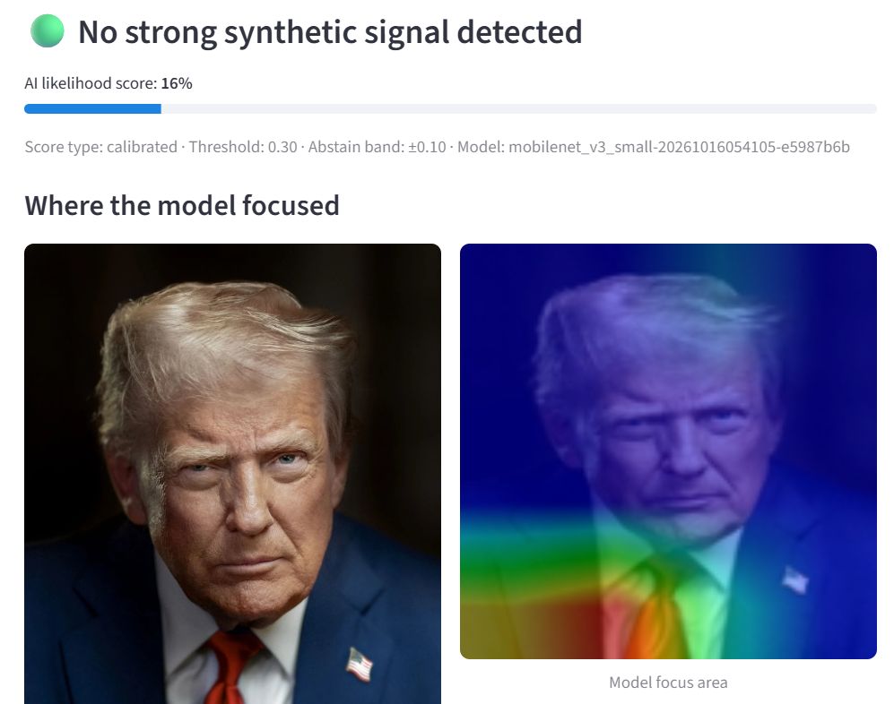
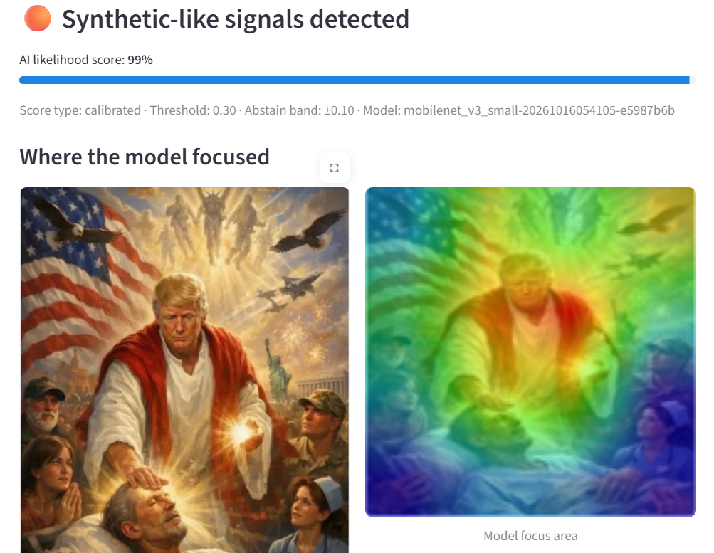

# VeriSight AI

**AI-generated image detector.** Upload or photograph an image to get a probabilistic estimate of whether it resembles AI-generated content.

A high score is not absolute proof that an image is fake, and a low score is not proof that it is authentic.

🔗 **Live app:** [verisightai.streamlit.app](https://verisightai.streamlit.app/)

| Real Image | AI-Generated Image |
| :---: | :---: |
|  |  |

---

## Model

| | |
|---|---|
| **Architecture** | MobileNetV3-Small (pretrained, input 128×128) |
| **Dataset** | [Defactify](https://huggingface.co/datasets/Rajarshi-Roy-research/Defactify_Image_Dataset) — ~96k images |
| **Calibration** | Temperature scaling fitted on validation set |
| **Decision threshold** | 0.30 with ±0.10 abstain band → three outcomes: `synthetic-like`, `inconclusive`, `no strong signal` |

### Test set results

| Metric | Score |
|---|---|
| ROC-AUC | 0.9386 |
| F1 | 0.9413 |
| Precision | 0.9448 |
| Recall | 0.9378 |
| Brier score | 0.0876 |

Results reflect a narrow benchmark domain (Defactify). They do not establish detection of deepfakes, face swaps, or real-world manipulated media.

---

## Local setup

**Requirements:** Python 3.11+, Git, bash

```bash
# 1. Clone
git clone https://github.com/realnoobestnoob/verisight-ai.git
cd verisight-ai

# 2. Create venv
python3 -m venv .venv && source .venv/bin/activate

# 3. Install PyTorch (CPU)
pip install --extra-index-url https://download.pytorch.org/whl/cpu \
  -r requirements/torch.txt

# 4. Install dependencies
pip install -r requirements/dev.lock.txt
pip install --no-deps -e .

# 5. Configure secrets (all optional — app works with empty values)
cp .env.example .env
# VERISIGHT_DATABASE_URL  — Neon PostgreSQL for scan logging
# VERISIGHT_LLM_*         — reserved; set provider to "none"

# 6. Verify
pytest
```

---

## Training

### 1. Download Defactify

```bash
pip install datasets tqdm
python scripts/download_defactify.py --out data/defactify

# Quick smoke (1k images/split):
python scripts/download_defactify.py --out data/defactify --max-per-split 1000
```

Expected layout:

```
data/defactify/
├── train/  REAL/ FAKE/
├── val/    REAL/ FAKE/
└── test/   REAL/ FAKE/
```

### 2. Run the pipeline

```bash
python -m verisight_ai.cli pipeline --config configs/defactify.yaml
```

Pipeline stages: environment validation → data validation + leakage check → split manifests → head training → fine-tuning → temperature calibration → threshold selection → test evaluation → robustness suite → CPU latency → candidate packaging.

Each run writes to a fresh `training_outputs/run-<timestamp>/` folder.

```bash
# Smoke test (synthetic data, validates plumbing only, ~1 min):
python -m verisight_ai.cli pipeline --config configs/defactify.yaml --demo

# Resume a failed run:
python -m verisight_ai.cli pipeline --config configs/defactify.yaml \
  --resume training_outputs/run-<timestamp>
```

### 3. View runs in MLflow

```bash
mlflow server --backend-store-uri sqlite:///mlflow.db --host 127.0.0.1 --port 5000
```

Open `http://127.0.0.1:5000`.

### 4. Promote a model

```bash
# Check gate
python -m verisight_ai.cli release \
  --candidate training_outputs/run-<timestamp>/candidate/<id>

# Promote
python -m verisight_ai.cli release \
  --candidate training_outputs/run-<timestamp>/candidate/<id> --promote

# Rollback
python -m verisight_ai.cli release --rollback
```

> **Note:** Release gate thresholds in `configs/defactify.yaml` (`min_test_roc_auc`, `min_test_f1`) are placeholders. Update them after your first baseline run.

---

## Running the app

```bash
streamlit run app.py
# → http://localhost:8501
```

The app starts even without a promoted model (reports model unavailable). Once a model is promoted, the Analyse button activates.

```bash
# Health check
python -m verisight_ai.cli health
```

---

## Repository layout

```
app.py                      Streamlit UI (upload / camera, result, Grad-CAM)
configs/
  defactify.yaml            Primary training config
  laptop.yaml               CPU subset config (2k/class, fast iteration)
scripts/
  download_defactify.py     Downloads Defactify from Hugging Face to disk
src/verisight_ai/
  pipeline.py               5-stage training orchestrator
  data.py                   Data validation, manifests, leakage checks
  model.py                  MobileNetV3-Small / EfficientNet-B0 builder
  train.py                  Training loop with MLflow logging
  calibration.py            Temperature scaling, threshold, abstain policy
  evaluate.py               Metrics, robustness suite, CPU latency
  explainability.py         Grad-CAM overlay
  inference.py              Shared predictor (app + gate + tests)
  release.py                Candidate packaging, gate, promote, rollback
  cli.py                    Entry point: pipeline / release / health / app / demo-data
  database.py               Neon / SQLAlchemy (no images or filenames stored)
  schemas.py                Typed result schemas; classifier verdict cannot be overridden
  config.py                 Typed pipeline and app settings
tests/
  test_pipeline_smoke.py    Full demo pipeline (slow; run explicitly with -v)
  test_*.py                 33 fast tests (run by default)
docs/
  DATA.md                   Dataset download and external evaluation checklist
  RELEASE.md                Promote, rollback, post-deploy smoke
  PRIVACY.md                What is and is not stored
model_artifacts/
  current.json              Pointer to active release (must be committed for deploy)
  releases/<id>/            Promoted bundles (model.pt, metadata.json, model_card.md)
```

---

## Design notes

- **Test-once discipline:** calibration and threshold are fit on validation only. The test set is evaluated exactly once with the frozen policy.
- **Three-outcome decision:** `synthetic-like` / `inconclusive` / `no strong signal` via a configurable abstain band. Scores are labelled "raw" unless calibration was accepted.
- **Privacy:** images are not stored. No filenames or message text in the database or logs. See `docs/PRIVACY.md`.